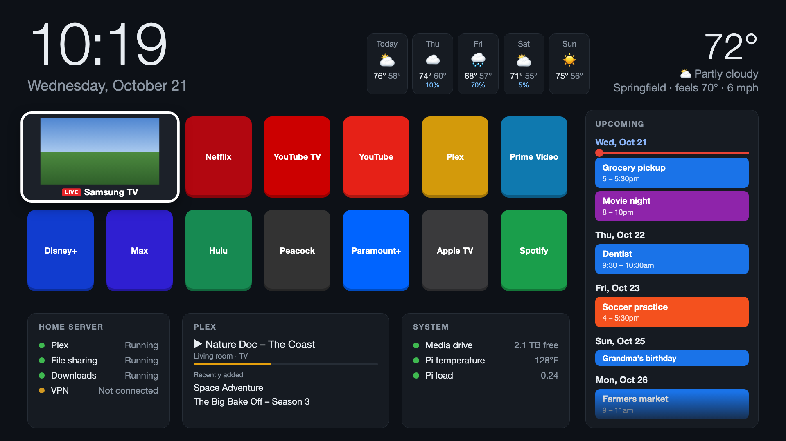

# Home TV Dashboard

A home screen for a 2019 Samsung QN75Q70R (Tizen 5.0), served from a Raspberry Pi.
When the TV turns on, the Pi opens the dashboard automatically.



<sub>Sample data from demo mode (`http://<pi>:8080/?demo=1`). On the TV, the left tile plays live TV.</sub>

- Clock, date and a 5-day forecast (Open-Meteo, no API key)
- App tiles that launch Netflix, YouTube TV, Plex and the rest on the TV
- A live Samsung TV preview tile that opens live TV / Samsung TV Plus
- An **Upcoming** column from Google Calendar (private iCal links) plus US holidays
- A row of configurable **widgets**; included: home server services, Plex now playing and
  recently added, and system health. [Write your own](pi/widgets/README.md).

## How it fits together

```
 TV (Tizen app "Home Dashboard")             Raspberry Pi (/opt/tv-dashboard)
 ┌───────────────────────────────┐           ┌─────────────────────────────────┐
 │ tizen-app/index.html          │  iframe   │ server.py (port 8080)           │
 │  - shows the Pi's dashboard   │ ────────► │  - serves static/index.html     │
 │  - live TV window + mute      │           │  - /api/weather /status /calendar│
 │  - opens built-in TV apps     │           │  - /api/launch → TV websocket   │
 └───────────────────────────────┘           │  - watcher: TV powers on →      │
              ▲                              │    launch the Home Dashboard app│
              └──────── TV remote API ◄──────└─────────────────────────────────┘
```

- **`pi/`** runs on the Pi as a systemd service. It talks to the TV over Samsung's
  local remote-control API (port 8002) using [`samsungtvws`](https://github.com/xchwarze/samsung-tv-ws-api).
- **`tizen-app/`** is a thin TV app. It loads the dashboard from the Pi, so most changes
  only need `scripts/deploy-pi.sh`, not a reinstall on the TV.

## Pi setup

On your computer, copy `local.env.example` to `local.env` and fill in the Pi's SSH address,
the TV's IP, the dashboard URL and your certificate profile name. Both scripts read it.

```bash
# on the Pi, once
sudo mkdir -p /opt/tv-dashboard && sudo chown pi:pi /opt/tv-dashboard
python3 -m venv /opt/tv-dashboard/venv
/opt/tv-dashboard/venv/bin/pip install samsungtvws icalendar recurring-ical-events

# from this repo, on your computer
scripts/deploy-pi.sh

# on the Pi, once
sudo systemctl enable tv-dashboard
```

Then on the Pi:

1. Create `/opt/tv-dashboard/config.local.json` from `pi/config.local.example.json` with your
   TV IP, dashboard URL, timezone and weather location. Its top-level keys replace those in
   `pi/config.json`, which holds the shared defaults (app tiles, services shown).
2. Create `/opt/tv-dashboard/calendars.json` from `pi/calendars.example.json`.
   Use each Google Calendar's **Settings → Integrate calendar → Secret address in iCal format**.
   This file contains private links. Both local files are git-ignored, and `deploy-pi.sh`
   never overwrites them.
3. The first time the Pi talks to the TV, choose **Allow** on the TV. The pairing token is
   saved to `/opt/tv-dashboard/tv-token.txt` (also git-ignored).

The service runs as `pi` and reads Plex's token from Plex's own `Preferences.xml` at runtime,
so no Plex credentials are stored here.

## TV app setup (one time)

1. **Developer Mode:** Home → Apps → enter `1 2 3 4 5` → turn Developer Mode on and set
   Host PC IP to your computer's IP → hold the power button to restart the TV.
2. **Tizen Studio CLI:** install from Samsung, then the `Certificate-Manager`, `cert-add-on`,
   `TV-SAMSUNG-Extension-Tools` and `TV-SAMSUNG-Extension-Resources` packages.
3. **Certificate:** in Certificate Manager create a *Samsung → TV* profile (needs a Samsung
   account; the TV's DUID is added automatically when the TV is connected).
4. Build and install: `scripts/install-tv-app.sh`. It fills in `DASHBOARD_URL` from
   `local.env`, so your address never lands in the repo.

Certificates live in `~/SamsungCertificate/` and are never part of this repo. Signed
`.wgt` packages are built in a temp folder and git-ignored.

## Google Photos slideshow (optional)

The `photos` widget shows random photos from a folder on the Pi. Since March 2025 Google only
lets apps read photos you pick, so the Pi has a pick page that copies chosen photos from Google
Photos into that folder. You can also drop photos into the folder yourself.

1. Pi: `/opt/tv-dashboard/venv/bin/pip install pillow` (used to resize photos for the TV), and
   set your folder in `config.local.json`: `"widget_options": {"photos": {"folder": "/path/to/Photos"}}`.
2. In [Google Cloud Console](https://console.cloud.google.com): create a project, enable the
   **Photos Picker API**, set up **Google Auth Platform** (External; add yourself as a test user),
   add the `photospicker.mediaitems.readonly` scope under Data Access, and create a
   **Desktop app** OAuth client. Download its JSON.
3. On your computer: `/usr/bin/python3 scripts/google-photos-auth.py client_secret_*.json`,
   then copy the resulting `google-photos.json` to `/opt/tv-dashboard/` on the Pi. Both files
   are git-ignored. (On macOS, `/usr/bin/python3` uses the system's certificates; a python.org
   install may fail with `CERTIFICATE_VERIFY_FAILED`.)
4. On your phone, open `http://<pi>:8080/api/widget/<index>/pick`, where `<index>` is the
   widget's position in `"widgets"`, starting at 0. Tap **Choose photos**, pick, and the Pi
   downloads them.

While the Google app is in Testing mode, the sign-in expires after 7 days. Photos already on the
Pi keep showing; re-run step 3 before picking more.

The picker can't select a whole album (search for the album's name and select its photos
instead). To keep **whole albums in sync**, share them by link and list them in `config.local.json`:
`"widget_options": {"photos": {"albums": [{"url": "https://photos.app.goo.gl/..."}]}}`. The Pi
re-checks every 6 hours (`album_sync_hours`) and copies new photos to `Albums/<name>/`, skipping
videos. Portrait photos are shown two at a time, side by side. This is
**unofficial**: it reads Google's public album page, covers only the first batch of photos it
lists (often a few hundred), and may stop working if Google changes that page. Anyone with an
album link can view the album, so keep links out of the repo.

## ecobee thermostats (optional)

The `ecobee` widget shows each thermostat's temperature, humidity, mode and its room sensors
(temperature and occupancy). ecobee stopped issuing developer API keys in 2024, so it reads the
thermostats locally over **HomeKit**, with no ecobee account or cloud. Read-only.

1. Pi: `/opt/tv-dashboard/venv/bin/pip install aiohomekit`
2. On each thermostat: **Settings → HomeKit**. Make sure HomeKit is enabled and note the 8-digit
   code. (A thermostat can belong to only one HomeKit home; if it's in Apple Home, remove it first.)
3. Find each thermostat's HomeKit id: `avahi-browse -rt _hap._tcp` on the Pi (the `id=` value).
4. Pair from the Pi:
   `/opt/tv-dashboard/venv/bin/python scripts/homekit-pair.py <id> <code> <alias>`.
   Keys go to `/opt/tv-dashboard/homekit-pairings.json` (git-ignored). The script saves them
   before anything else. aiohomekit 4's own `aiohomekitctl pair` doesn't save new pairings, which
   leaves the thermostat paired to nobody until you reset its HomeKit pairing.

## Third-party code

`pi/widgets/logo-3d/three-r128.js` is [Three.js](https://threejs.org) r128 (MIT license,
copyright 2010-2021 Three.js Authors), included unmodified.

## Notes and limitations (2019 Q70R)

- Third-party apps can't start themselves at power-on, so the Pi's watcher launches the
  app when the TV's API reports it turned on. For reliable start-up, turn **off** Autorun Smart
  Hub, Autorun Samsung TV Plus and Autorun Last App (Settings → General → Smart Features).
  The Pi holds the TV muted over UPnP while it wakes (the TV resumes live TV with sound),
  launches the dashboard about 10 seconds in, and relaunches it if the TV pushes it aside.
  The live preview starts about 20 seconds after the dashboard does; starting it earlier makes
  the TV jump to full-screen live TV.
- Samsung TV Plus / live TV can't be opened through the remote API (it returns a
  "server under maintenance" error). The TV app opens `org.tizen.tv-viewer` itself instead.
- The live preview uses `tizen.tvwindow`. On this model video is drawn **above** all web
  content, so nothing can overlay it. That's why the preview tile is a card with the label
  below the video. The TV is muted while the preview is on and unmuted when you leave.
- Sideloaded apps are signed with a Samsung certificate that eventually expires. Re-run
  Certificate Manager and `install-tv-app.sh` when that happens.
